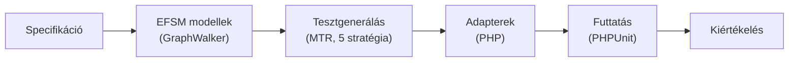

# 🚴 Kétkeréken - Fórum modul

Ez a repó egy Kétkeréken nevű kerékpáros/motoros közösségi weboldal csapatprojektjét tartalmazza (Laravel). Az alábbi README **az általam (Kiss István, T73N0W) készített részeket** írja le:

1. a **Fórum modul**, amelyet teljes egészében én fejlesztettem,
2. a Fórum modulhoz készített **modellalapú tesztelési (MBT) projekt**.

A regisztráció és bejelentkezés nem az én munkám, a fórum funkciói viszont arra épülnek.

---

## 📑 Tartalomjegyzék

1. [Fórum modul](#1-fórum-modul)
2. [Modellalapú tesztelés (MBT)](#2-modellalapú-tesztelés-mbt)
3. [Képernyőképek és demó](#3-képernyőképek-és-demó)

---

## 1. Fórum modul

A fórum a közösség tagjainak beszélgetésére szolgál: kategóriákba rendezett bejegyzéseket lehet böngészni, létrehozni, értékelni, kommentelni, menteni és jelenteni. A bejegyzések megtekintése bárkinek elérhető, minden más funkcióhoz regisztráció és bejelentkezés kell.

### 1.1 Oldalak

| Oldal | Leírás |
|---|---|
| **Fórum főoldal** | A kategóriák listája. Minden kategória alatt a 5 legkedveltebb bejegyzés jelenik meg kártyás előnézetben (cím, posztoló, rövid leírás, like-ok és dislike-ok száma). |
| **Kategória oldal** | Az adott kategória összes bejegyzése listában, keresővel, rendezéssel és szűrőkkel. Innen hozható létre új bejegyzés. |
| **Bejegyzés oldal** | Egy bejegyzés részletes nézete: az előnézet adatai, a teljes szöveges tartalom és a kommentek. |
| **Új bejegyzés oldal** | Űrlap új bejegyzés létrehozásához. |
| **Szerkesztés oldal** | A bejegyzés tulajdonosa itt módosíthatja a bejegyzését. |
| **Mentett fórumok** | A felhasználó által mentett bejegyzések, a kategória oldalhoz hasonló szűréssel. |

A bejegyzések kizárólag szöveget tartalmazhatnak, képek és fájlok feltöltése nem támogatott.

### 1.2 Kategória oldal: keresés, rendezés, szűrés

- **Élő keresés** a bejegyzések címe alapján, gépelés közben.
- **Rendezés:**
  - ábécé szerint (A–Z, Z–A)
  - dátum szerint (legújabb elöl, legrégebbi elöl)
  - legkedveltebb elöl
- **Szűrők:**
  - jelentett bejegyzések elrejtése
  - dislike-olt bejegyzések elrejtése

A keresés, a rendezés és a szűrők együtt is használhatók. A mentett fórumok oldal hasonló szűrési lehetőségeket kínál.

### 1.3 Bejegyzés oldal

**Minden bejelentkezett felhasználónak:**

- **Like / dislike:** egyszerre egy reakció lehet aktív, váltani és visszavonni is lehet.
- **Kommentelés:** a bejegyzések alá hozzászólás írható.
- **Jelentés:** felugró ablakban szövegmezővel és jelentési ok jelölőnégyzetekkel, megerősítéssel. Egy felhasználó egy bejegyzést csak egyszer jelenthet, és ha egy bejegyzésre több mint 3 jelentés érkezik, automatikusan törlődik.
- **Mentés / mentés visszavonása:** a mentett bejegyzések a Mentett fórumok oldalon érhetők el. A mentés visszavonása megerősítést kér.

**A bejegyzés tulajdonosának (a fentieken túl):**

- **Szerkesztés:** a szerkesztő oldalra visz, a módosítás csak megerősítéskor lép érvénybe.
- **Törlés:** megerősítéssel.

### 1.4 Kommentek

A kommentekre ugyanazok a műveletek érhetők el, mint a bejegyzésekre (kivéve a mentést):

- like és dislike
- jelentés
- szerkesztés és törlés a komment tulajdonosának

A kommentekre nem lehet tovább kommentelni.

### 1.5 Új bejegyzés létrehozása

Az új bejegyzés a kategória oldalról hozható létre. A létrehozás csak megerősítéskor lép érvénybe. Lemondás esetén a felhasználó változtatás nélkül visszatér a kategória oldalra.

### 1.6 Szabályok

- Megtekintésen kívül minden funkcióhoz bejelentkezés szükséges.
- Egy felhasználónak bejegyzésenként egy aktív reakciója (like vagy dislike) lehet.
- Egy felhasználó egy bejegyzést csak egyszer jelenthet.
- A bejegyzés létrehozása és szerkesztése csak megerősítésre lép érvénybe.
- A szerkesztés és törlés a bejegyzés tulajdonosának tartja fenn magát.

### 1.7 Technológiák

| Terület | Technológiák |
|---|---|
| **Backend** | PHP, Laravel (kontrollerek, Eloquent modellek, Blade nézetek) |
| **Frontend** | Blade, JavaScript (élő keresés, rendezés, szűrés, like/dislike) |
| **Tesztelés** | PHPUnit, GraphWalker, MTR |

---

## 2. Modellalapú tesztelés (MBT)

A Fórum modulhoz modellalapú tesztelési projektet is készítettem. A cél a rendszer **logikai működésének** ellenőrzése volt, a grafikus felület, a stílus, a hálózati és teljesítményi viselkedés nem része a tesztelésnek.

### 2.1 Folyamat

### 2.2 Modellek

A rendszert három, GraphWalkerben készített EFSM modell írja le, hogy mindegyik külön tesztelhető és átlátható maradjon.

| Modell | Mit ír le | Fő állapotok |
|---|---|---|
| **Navigation** | Az oldalak közti navigáció és a belépés/kilépés | LoggedOut, ForumMain, ForumList, ForumPost, CreatePostPage |
| **Post page** | Egy bejegyzés oldalán végezhető műveletek | PostPage, PostLiked, PostDisliked, EditPostPage, End |
| **List page** | Keresés, szűrés, rendezés a kategória oldalon | ListDefault, ListFiltered, ListSortedAZ / ZA / Newest / Oldest / MostLiked |

**Szándékos egyszerűsítések** (az állapotrobbanás elkerüléséért és a teljes lefedettségért):

- **Navigation:** az űrlapkitöltést számláló változó (`formFilledOut`) váltja ki, és a kategóriák egyetlen absztrakt kategóriaként jelennek meg.
- **Post page:** a felhasználó többször is jelenthet. A like/dislike váltás és a szerkesztés korlátozott számú, a szerkesztésből csak megerősítéssel lehet kilépni. Az automatikus törlés nincs modellezve, mert ugyanazt a mechanizmust fedné le, mint a törlés. Folyamatos futtatáshoz bekerült egy bejegyzés-újralétrehozó átmenet (`e_newPost`).
- **List page:** az összes szűrő egyetlen "filtered" állapotba van vonva, a szűrők kombinációját számláló korlátozza, a keresés pedig logikai változó, tényleges szövegegyeztetés nélkül.

### 2.3 Tesztgenerálás

A modellekből MTR-rel generáltam teszteket, öt stratégiával. Az FSM-alapú algoritmusokhoz az EFSM modelleket FSM-mé kellett alakítani (reset átmenetekkel), ez a guardok elhagyása miatt növelte az állapotteret, különösen a Post modellnél.

| Stratégia | Lefedési cél | Jellemző |
|---|---|---|
| **Random (R)** | Minden átmenet (`edge_coverage(100)`) | Gyors, de változó és redundáns, 5 futtatás |
| **Transition Tour (TT)** | Minden átmenet | Legrövidebb, determinisztikus |
| **1 Switch Coverage (1SC)** | Átmenet-párok | Hosszabb, az egymást követő műveletek kapcsolatát vizsgálja |
| **All Transition State (ATS)** | Minden átmenet minden elérhető állapotból | Állapotfüggő viselkedés mélyebb vizsgálata |
| **HSI** | Állapotok megkülönböztethetősége | Legtöbb lépés, reset átmenetekkel |

Mind a három modellnél minden stratégia 100%-os átmenetlefedettséget ért el, a generálás ideje elhanyagolható volt (kevesebb mint 0,1 s).

| Tulajdonság | R | TT | 1SC | ATS | HSI |
|---|---|---|---|---|---|
| Szekvenciahossz (min) | 24 | 22 | 90 | 65 | 1265 |
| Szekvenciahossz (max) | 229 | 129 | 921 | 437 | 11072 |
| Szekvenciahossz (átlag) | ~60 | 91 | ~450 | ~307 | ~7168 |

*(A három modell adatai átlagolva.)*

### 2.4 Adaptálás

Az absztrakt modellátmeneteket PHP adapterosztályok kötik a valódi Laravel alkalmazáshoz (`NavigationAdapter`, `ListAdapter`, `PostAdapter`). Mindegyik adapter ugyanazt a szerkezetet követi:

- **Szekvenciafuttató** (`runInputSequence`): a GraphWalker által generált bemeneteket sorban végrehajtja.
- **Leképezés** (`mapInputToMethod`): a szöveges bemeneteket konkrét metódusokra képezi le, ez az adaptáció központi határa.
- **Állapotváltozók:** a modell állapotát tükrözik (pl. `hasLiked`, `switchStreak`), a guardokat szimulálják, és nem a tesztelt rendszerből származnak.
- **Inicializálás:** a konstruktor létrehoz egy felhasználót, kategóriát és bejegyzést factoryk segítségével, és bejelentkezteti a felhasználót, így a tesztek izoláltak.

**Modellenkénti megközelítés:**

| Modell | Megközelítés |
|---|---|
| **Navigation** | Tisztán HTTP alapú: minden átmenet egy valódi útvonalhívás, a válaszkód ellenőrzésével. |
| **List** | A keresés, szűrés és rendezés JavaScriptben van megvalósítva, amit a Laravel tesztek nem tudnak futtatni. Az adapter ezért szimulálja az állapotátmeneteket, így az állapotlogika és a guardok validálhatók, valódi DOM nélkül. |
| **Post** | Hibrid: a valódi háttérműveletek (megnyitás, szerkesztés, reakciók mentése, komment) HTTP hívásokkal futnak, a frontend logikát (like/dislike váltás, mentés kapcsoló, szerkesztési mód) szimuláció adja. A törlés és az újralétrehozás szimulált, mert megszakítaná a teszt folytonosságát. |

### 2.5 Eredmények

A tesztek futtatása: `php artisan test`

| Teszt | R | TT | ATS | 1SC | HSI |
|---|:-:|:-:|:-:|:-:|:-:|
| **ListTest** | ✅ | ✅ | ✅ | ✅ | ✅ |
| **PostTest** | ✅ | ✅ | ✅ | ✅ | ✅ |
| **NavigationTest** | ❌ | ❌ | ❌ | ❌ | ❌ |

- **List modell:** minden szekvencia sikeres, ami megerősíti az adapter és a modell konzisztenciáját.
- **Post modell:** minden szekvencia sikeres. A tesztelt háttér-útvonalak: megnyitás, módosítás, reakciók mentése, kommentelés.
- **Navigation modell:** mind az öt teszt elbukott, a tesztek **valódi hibákat tártak fel** az alkalmazásban:
  1. **Hiányzó útvonalparaméter:** a Blade sablonok paraméter nélkül generálnak útvonalat (`route('forum.create')`), miközben az útvonal `forum/{category}/create` alakú, ezért `Missing required parameter: category` hiba lép fel.
  2. **Nem definiált `$errors` változó:** a nézet feltételezi, hogy a `$errors` mindig létezik, tesztkörnyezetben azonban a validációs/session környezet nem ugyanúgy inicializálódik, ezért a válasz 500 (`Undefined variable $errors`). Ez a nézetréteg robusztussági hibája.

---

## 3. Képernyőképek és demó

### 📋 TODO
- [ ] Rövid demó videó

